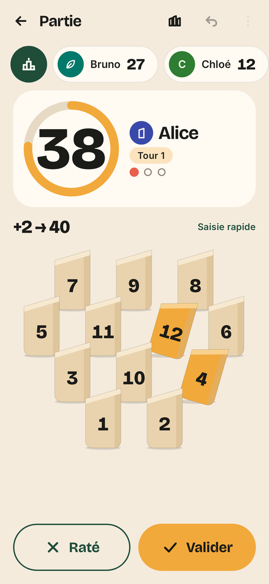
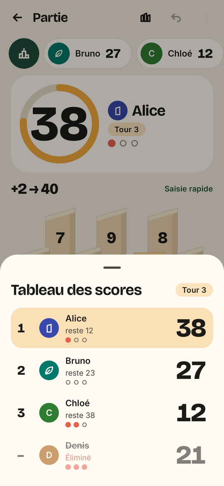
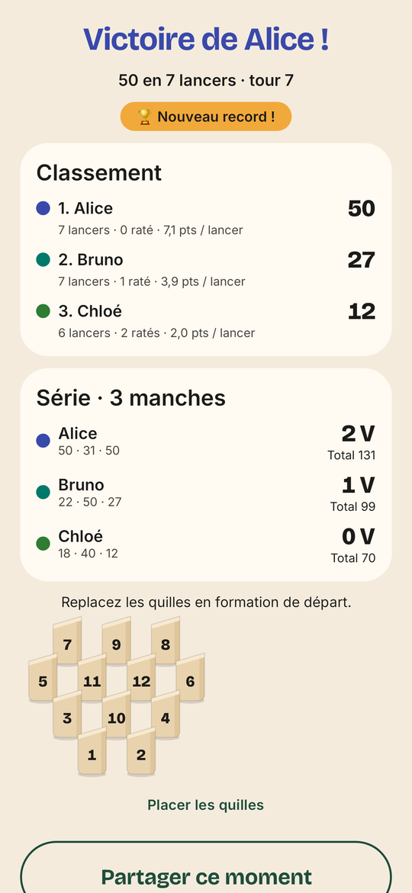
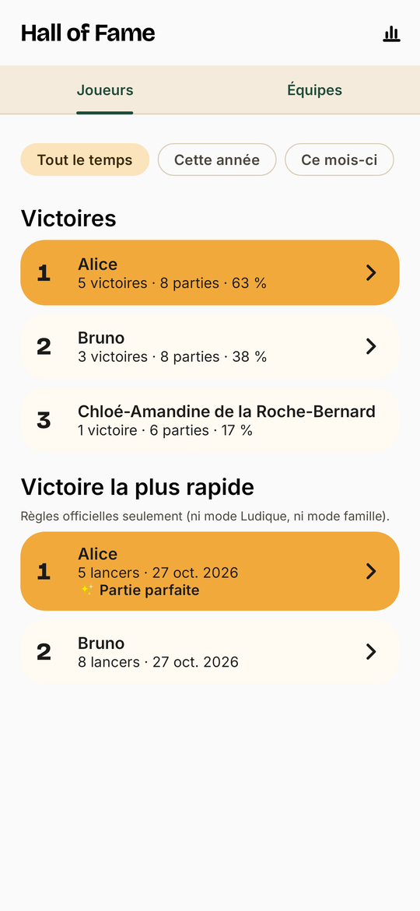
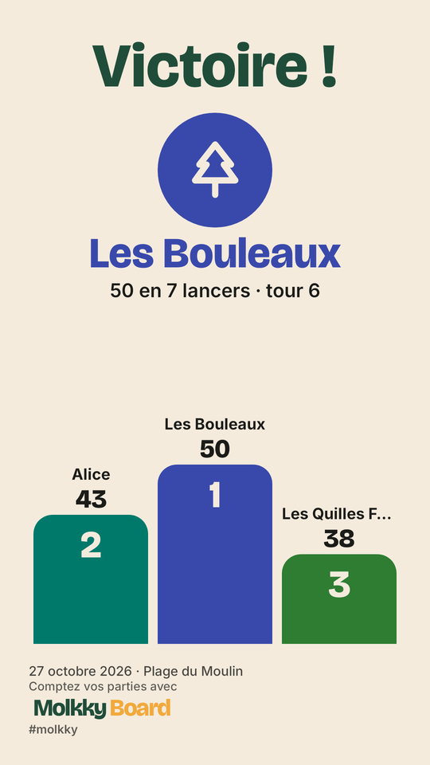
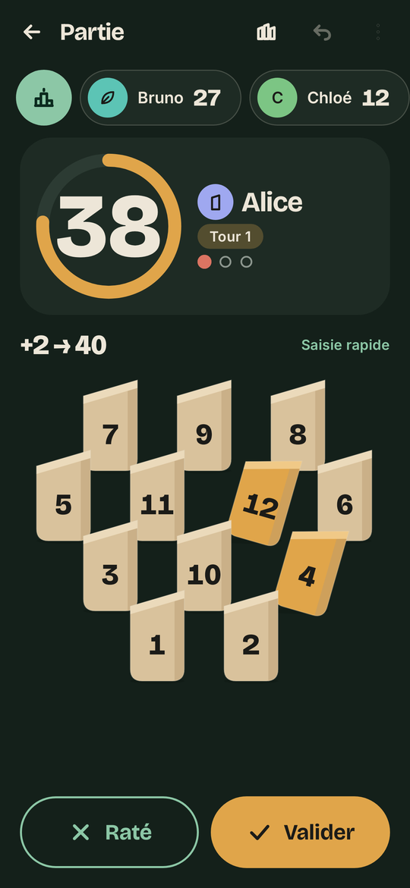

# Molkky Board

**Le tableau de score du Mölkky, sans publicité ni traceur.** Une application Android de [Yogi Studio](#crédits)
pour compter les parties : on touche les quilles tombées, l'app applique les règles, calcule les scores et garde
l'historique.

> Version actuelle : **0.8.1** (build 9, version de test). APK de test : [0.8.0](https://github.com/GuillaumeCHR/molkky-board/releases/tag/v0.8.0).
> Identifiant : `com.yogistudio.molkkyboard`.

## Aperçu

| | | |
|:---:|:---:|:---:|
|  |  |  |
| Saisie du lancer | Tableau des scores | Fin de partie |
|  |  |  |
| Hall of Fame | Vignette à partager | Thème sombre |

## Ce qu'elle fait

- **Saisie en deux gestes** : touchez les quilles tombées (ou le pavé rapide 0 à 12), puis « Valider ».
  Rien n'est enregistré sans validation, et l'annulation est à portée de pouce.
- **Les règles appliquées pour vous** : 50 points exactement, retour à 25 en cas de dépassement, élimination
  après trois ratés, match en plusieurs manches, belle et Mölkkout. Mode **Officiel** (règlement IMO en option)
  ou **Ludique** (variantes, mode famille).
- **Partie à côté** : plusieurs téléphones sur le même terrain suivent et saisissent la même partie, via un QR code,
  sans compte, sans serveur et sans Internet (point d'accès local ou même Wi-Fi).
- **Tout se corrige** : n'importe quel lancer passé se modifie ou se supprime, et tout est recalculé (scores,
  retours à 25, éliminations, vainqueur).
- **En équipes** : équipes nommées (🎲 pour un nom au hasard), couleur et emblème, ordre de passage par
  glisser-déposer.
- **Des moments qui claquent** : animation « 12 ! », retour à 25, élimination, victoire, annonces vocales.
- **Mémoire de vos parties** : historique complet, statistiques, Hall of Fame, records et badges.
- **Partage** : vignettes, mini-vidéo, GIF et photo du moment, générés sur le téléphone.
- **Pour tout le monde** : grandes polices jusqu'à 2,0, TalkBack, mode « Plein soleil », français et anglais.
- **Guide intégré** : règles illustrées, placement des quilles, questions fréquentes.

## Vie privée

**Aucune donnée collectée. Molkky Board ne se connecte jamais à Internet.**

- Aucune publicité, aucun traceur publicitaire, aucun outil de mesure d'audience, aucune donnée revendue.
- Tout reste sur votre téléphone, sauf ce que vous choisissez vous-même de partager.
- Sauvegarde, export (JSON) et suppression de vos données à tout moment, dans Réglages › Données.
- **0 traceur** selon les signatures d'Exodus Privacy, contrôlé dans la CI : voir le
  [rapport de traceurs](docs/privacy/RAPPORT_TRACEURS.md) (permissions comprises).
- Les permissions de l'APK sont une liste blanche vérifiée à chaque build (`check<Variante>Permissions`) : jamais de localisation, de contacts ni d'identifiant publicitaire. La permission `INTERNET` ne sert qu'aux sockets de la partie à côté, sur le réseau local.

**Partie à côté** : plusieurs téléphones jouent ensemble sur le même terrain, directement entre eux (point d'accès
local ou même Wi-Fi), en TLS 1.3 avec l'empreinte du certificat de la partie épinglée depuis le QR code, sans serveur,
sans compte et sans Internet. L'organisateur accepte chaque téléphone ; son téléphone valide chaque lancer.

## Construire et lancer

Prérequis : JDK 21 et le SDK Android avec la plateforme `android-37` (`$ANDROID_HOME` défini, ou `sdk.dir` dans
`local.properties`). Le wrapper Gradle télécharge le reste.

```bash
./gradlew :app:assembleDebug        # APK : app/build/outputs/apk/debug/app-debug.apk
./gradlew test                      # tests unitaires, captures Roborazzi et contrôles d'accessibilité
./gradlew :core:scoring:koverVerify :core:sync:koverVerify   # couverture du moteur et de la validation
./gradlew ktlintCheck detekt lintDebug                        # style et analyse statique
```

Sur l'émulateur :

```bash
android emulator start Medium_Phone_API_37.0
./gradlew :app:installDebug
adb shell am start -n com.yogistudio.molkkyboard.debug/com.yogistudio.molkkyboard.MainActivity
```

Les APK de test sont aussi publiés dans les [releases](https://github.com/GuillaumeCHR/molkky-board/releases)
(dernière : [0.8.0](https://github.com/GuillaumeCHR/molkky-board/releases/tag/v0.8.0)). La version debug s'installe
à côté d'une éventuelle version du Play Store (identifiant `com.yogistudio.molkkyboard.debug`). Pour la partie à côté,
tous les téléphones doivent avoir la même variante.

Version release signée (AAB pour le Play Store) : voir [`docs/RELEASE.md`](docs/RELEASE.md).

## Architecture

Kotlin, Jetpack Compose et Material 3, une seule activité, Hilt, Room. L'état d'une partie n'est jamais stocké :
il est recalculé à partir d'un **journal d'événements** par une fonction pure, ce qui rend possibles l'annulation,
la correction de n'importe quel lancer et la synchronisation entre téléphones (le téléphone de l'organisateur
valide et ordonne le journal).

| Module | Rôle |
|---|---|
| `build-logic/` | plugins de convention Gradle (Android, Compose, Hilt, Kotlin pur, lint) |
| `app` | activité unique, navigation, injection, À propos |
| `core:model` | types partagés (Kotlin pur) |
| `core:scoring` | moteur de score : rejeu du journal, match, Mölkkout (Kotlin pur, 100 % des lignes couvertes) |
| `core:stats` | statistiques, Hall of Fame, records et moments forts, recalculés depuis les journaux (Kotlin pur) |
| `core:sync` | validation partagée des événements et commandes de partie, pour plusieurs téléphones (Kotlin pur) |
| `core:nearby` | partie à côté : point d'accès local ou même Wi-Fi, serveur et client WebSocket en TLS épinglé, service de premier plan |
| `core:designsystem` | thème « Nordic Bold », quilles, emblèmes au trait, logotype, sons |
| `core:database` | Room : parties, manches, journal d'événements, profils, équipes |
| `core:datastore` | réglages (DataStore) |
| `core:data` | dépôts (Room comme source de vérité), sauvegarde et restauration |
| `feature:*` | `intro`, `setup`, `game`, `history`, `stats`, `share`, `nearby` (inviter, rejoindre) |

Documentation : [règles](docs/RULES.md) · [moteur de score](docs/SCORING_SPEC.md) ·
[statistiques](docs/STATS_SPEC.md) · [architecture et jalons](docs/ARCHITECTURE.md) ·
[modèle de menaces](docs/security/THREAT_MODEL.md). Les versions des dépendances sont centralisées dans
`gradle/libs.versions.toml`.

## Crédits

| | |
|---|---|
| **Production** | Yogi Studio — studio indépendant, effectif total : une personne et une quille en posture du lotus |
| **Développement, design, tests et service après-vente** | Yogi (a aussi tenu le rôle de stagiaire, de chef de projet et de Product Owner ; les réunions ont été courtes) |
| **Pair programming** | Claude (Anthropic), via Claude Code — n'a jamais lancé une seule quille, mais connaît la règle du retour à 25 par cœur |
| **Moteur de score** | une fonction pure, sans effet de bord (on ne peut pas en dire autant d'un mölkky lancé trop fort) |
| **Physique des quilles** | Isaac Newton, consultant posthume, non rémunéré |
| **Direction artistique** | « Nordic Bold » : bouleau `#F4EBDD`, forêt `#1F4D3A`, safran `#F2A93B`, corail `#E8604C` |
| **Typographies** | Bricolage Grotesque (Mathieu Triay) et Inter (Rasmus Andersson), SIL Open Font License 1.1 |
| **Matériel de test** | un PC portable vaillant sous Zorin OS et son émulateur Android ; aucun PC n'a été blessé, presque |

Construite avec des bibliothèques open source (Apache 2.0, MIT, BSD), listées dans l'app (À propos › Bibliothèques
open source).

| Statistiques de production | |
|---|---|
| Publicités | 0 |
| Traceurs | 0 |
| SDK d'analytics | 0 |
| Cookies | 0 (pas les crêpes) |
| Données revendues | 0 |
| Quilles | 12 |
| Points pour gagner | 50, pas un de plus |

Le Mölkky a été inventé en Finlande en 1996. Kiitos ! Les règles présentées dans l'app sont reformulées à partir
des règles officielles. Mölkky® est une marque de Tactic Games Oy ; Molkky Board est une application
indépendante, ni affiliée ni approuvée par le détenteur de la marque.

Aucun arbre n'a été abattu pour réaliser cette application.

## Licence

Copyright © 2026 Yogi Studio.

Molkky Board est un logiciel libre : vous pouvez le redistribuer et le modifier selon les termes de la
**[GNU General Public License v3](LICENSE)** (ou toute version ultérieure), publiée par la Free Software
Foundation. Il est distribué dans l'espoir d'être utile, mais **sans aucune garantie**. Toute version
redistribuée, modifiée ou non, doit rester sous GPL v3 et publier son code source.

Les noms « Molkky Board » et « Yogi Studio », leurs logos et l'icône de l'application ne sont pas couverts par la
licence : voir [`TRADEMARKS.md`](TRADEMARKS.md).

## Contact

Yogi Studio : **yogistudiofr@gmail.com** (retours, questions, marques). Vulnérabilités : voir
[`SECURITY.md`](SECURITY.md).
