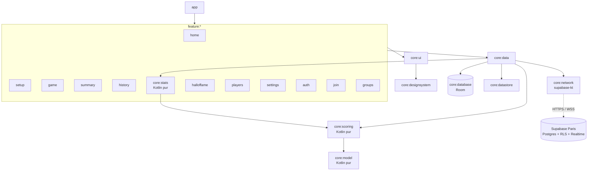
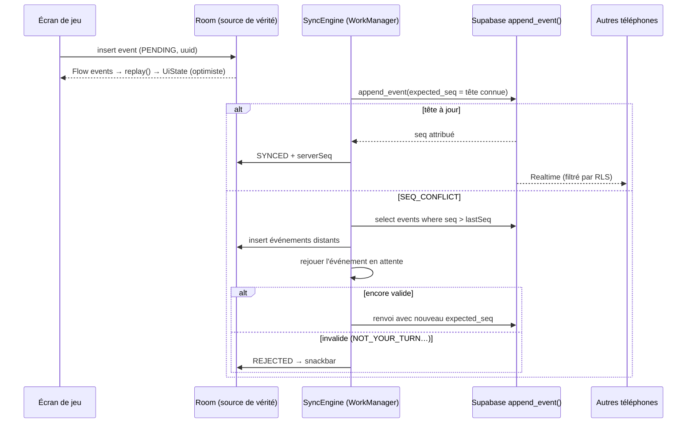

# Architecture — Molkky Board

> Validée le 2026-10-25 (Phase 2). Règles : [`RULES.md`](RULES.md) · moteur : [`SCORING_SPEC.md`](SCORING_SPEC.md).
> Décisions résumées dans `CLAUDE.md` § Décisions.

## Vue d'ensemble



## Flux d'un lancer en partie partagée



## Environnement de développement

Vérifié le 2026-10-25 : OpenJDK 21, Android SDK (`android-37.0`, build-tools 36), Android CLI, émulateur `Medium_Phone_API_37.0`. Gradle 9.8.2 (wrapper), AGP 9.4.1, Kotlin 2.4.21. CLI Supabase + Docker à installer au J6.

## 1. Socle — base suggérée conservée
- Kotlin + Compose + Material 3, une seule Activity, Navigation Compose à routes typées, MVVM/UDF
  (le ViewModel expose un `StateFlow<UiState>` et reçoit des `Action`s). Hilt, KSP.
- minSdk 26 ; targetSdk et compileSdk = dernière API stable, vérifiée au J0.
- **Challenge** : j'ajoute **WorkManager** (+ hilt-work) au catalogue, absent de la stack. Il
  garantit l'envoi des lancers saisis hors ligne même si l'app est tuée. Tout le reste de la stack
  demandée est repris tel quel.

## 2. Modules
```
build-logic/            convention plugins (android-library, compose, hilt, jvm-library, feature, test)
app/                    Activity, NavHost, injection globale
core:model              Kotlin pur — identifiants, Player, Team, GameConfig (types partagés)
core:scoring            Kotlin pur — moteur (reduce/fold), Mölkkout, Match ; dépend seulement de
                        core:model et kotlinx-serialization. Structuré pour passer en KMP plus tard
core:stats              Kotlin pur — résumés de partie et classements (Hall of Fame) calculés depuis les journaux
core:designsystem       thème Nordic Bold, tokens, typo, PinView, QuickPad, ScoreRing, PlayerChip, BigActionButton,
                        FitToScreen, logotype, logo Yogi Studio
core:ui                 composables métier partagés (grille de quilles, bandeau joueurs)
core:database           Room (entités, DAO, migrations exportées)
core:datastore          DataStore Preferences (réglages, préréglage de règles, « Plein soleil »)
core:network            [Phase 4] supabase-kt + Ktor OkHttp, DTO
core:data               repositories (source de vérité = Room) + SyncEngine [Phase 4]
core:share              [J6] rendu des vignettes (Compose → bitmap) et encodage des mini-vidéos
core:testing            fakes, règles de test, données de test
feature:intro | home | setup | game | summary | history | stats | halloffame | players | settings | share | rules
feature:auth | join | groups   [Phase 4]
```
Règles de dépendance : `feature:*` → `core:data`, `core:ui`, `core:designsystem` uniquement ; les
features ne dépendent jamais les unes des autres ; `core:scoring` et `core:stats` ne connaissent pas Android.

## 3. Moteur de score (`core:scoring`)
- `reduce(SetState, Event): Result<SetState, ScoringError>` est pure ; `replay(config, teams, log)`
  est l'unique façon d'obtenir un état.
- Le **journal est en ajout seul** : `Undo(targetId)` et `Correct(targetId, replacement)` sont
  eux-mêmes des événements. Le rejeu calcule d'abord le *journal effectif*, puis le plie. Cela rend la
  synchro triviale (on n'efface jamais rien côté serveur) et garde une **piste d'audit** des
  corrections.
- Un événement invalide au rejeu (par exemple un lancer arrivé après la fin) est **ignoré de façon
  déterministe** et signalé : tous les appareils convergent vers le même état.
- **Moteur v2** (validé le 2026-10-25, détail dans `SCORING_SPEC.md` § 15) :
  - un lancer est **attribué par sa position** dans le journal effectif (le lanceur du moment) ; le champ
    `by` n'est vérifié qu'à la saisie (`checkInput`). Supprimer un doublon réattribue la suite aux bons joueurs ;
  - `ThrowResult = Pins | Points` : mode « Quilles » (stats par quille) et mode « Rapide » ;
  - nouveaux événements `Delete`, `AddPlayer`, `RemovePlayer`, `Reorder` (entre deux tours) ;
  - les règles sont une **stratégie** `ScoringRules` (implémentation `StandardRules(config)`) : de futures
    variantes de jeu se brancheront sur le même journal ;
  - `modifiedAfterFinish` remplace `corrected` pour l'éligibilité aux records.
- Tests : un test JUnit 5 paramétré par cas de `SCORING_SPEC.md` (identifiants P1…X7 dans le nom
  des tests), plus des tests de propriétés maison (journaux aléatoires valides : score toujours dans
  [0, cible], « ajout puis Undo = identité »). Couverture vérifiée par **Kover** (`koverVerify`, en CI) :
  100 % des lignes et ≥ 97 % des branches (moteur v2 : 97,5 %). Les classes `@Serializable` sans logique sont
  exclues de la mesure (code généré) ; les branches restantes sont inatteignables (tests de nullité générés par
  Kotlin, cas « liste vide » de `minOf` alors qu'une manche en cours a au moins deux équipes en lice).

## 4. Données locales (offline-first)
- Tables Room : `player_profile` (profils locaux réutilisables), `game` (config sérialisée en JSON,
  statut, code de partage nullable), `game_team`, `game_player`, `game_event` (identifiant UUID
  généré sur l'appareil, `localSeq`, `serverSeq` nullable, `syncState` PENDING/SYNCED/REJECTED,
  payload JSON), `team` (identité d'équipe : nom, couleur, emblème, `member_key` unique, voir § 10).
  **Aucun résultat ni statistique n'est stocké en dur** (la table `set_result` prévue initialement est supprimée).
- L'état d'une partie n'est **pas stocké** : `Flow<List<GameEvent>>` → `replay()` → `UiState`
  (moins de 200 événements par manche, recalcul négligeable). Les stats et le Hall of Fame sont
  calculés par `core:stats` à partir des journaux (§ 10).
- **Aucune partie perdue** : chaque événement validé est écrit dans Room avant que l'UI n'avance (transaction
  courte). Au démarrage, `StartupLoader` détecte une partie en cours et l'accueil propose de la reprendre ;
  test instrumenté dédié (mort du processus, redémarrage du téléphone).
- Réglages (DataStore) : mode de saisie, langue, « Plein soleil », annonces vocales, sons, coach, intro courte,
  compteur de lancements, prise en main vue.
- Le mode « un seul téléphone » fonctionne sans compte ni réseau : les modules réseau sont injectés
  mais inactifs tant qu'on ne partage pas la partie.

## 5. Backend : recommandation **Supabase (région UE)**

| Critère | Supabase | Firebase |
|---|---|---|
| Hébergement UE | Projet entier (Auth incluse) dans une région UE : Francfort, Paris, Stockholm… | Firestore en UE possible, mais **Firebase Auth traite les données aux États-Unis** (passer à Identity Platform pour aller plus loin) |
| Modèle d'accès | **RLS Postgres** : SQL testable (pgTAP), versionné en migrations | Security Rules : langage dédié, bon émulateur, moins expressif pour les jointures de rôles |
| Journal ordonné | séquence par partie attribuée **dans une fonction SQL transactionnelle** : ordre total garanti | transactions Firestore possibles, mais compteur unique par partie, coût en lectures, logique côté client ou Cloud Functions |
| Temps réel | Realtime `postgres_changes`, **filtré par RLS** | listeners Firestore, très mûrs, avec un cache hors ligne intégré (gros atout) |
| Hors ligne | à notre charge : Room + boîte d'envoi (on le veut de toute façon, Room étant la source de vérité) | natif, mais doublonne avec Room |
| Réversibilité | open source, **auto-hébergeable** chez un hébergeur UE (Scaleway, OVH…) : sortie du CLOUD Act possible plus tard | enfermement propriétaire |
| Coûts / pièges | l'offre gratuite **met en pause un projet inactif depuis 7 jours** | gratuit généreux |

**Choix : Supabase en région UE, Paris (`eu-west-3`)**, pour quatre raisons : toutes les données restent en UE, RLS est
auditable et testable, l'ordre du journal est garanti par une transaction SQL, et l'auto-hébergement
reste possible. Le principal atout de Firebase (cache hors ligne) ne sert pas ici, puisque Room est
déjà la source de vérité. Risque résiduel : Supabase Inc. est une société américaine (même
exposition que Google) ; l'auto-hébergement est la porte de sortie.

### Schéma (migrations dans `supabase/migrations/`)
- `profiles(user_id PK → auth.users, display_name, color)` : rien d'autre (pas d'avatar distant en v1,
  les avatars restent locaux).
- `games(id, owner_id, config jsonb, status, join_code UNIQUE, join_code_expires_at, created_at)`.
- `game_members(game_id, user_id, role organizer|player)`.
- `game_players(game_id, player_id, team_id, order, display_name, user_id NULL)` : `user_id` est NULL
  pour un invité sans compte.
- `game_events(game_id, seq, id uuid UNIQUE, kind, payload jsonb, author_id, client_ts, server_ts)`.
- **Pas d'INSERT direct** : RLS n'autorise que le SELECT aux membres. Toute écriture passe par des
  fonctions `security definer` :
  - `append_event(game_id, event_id, expected_seq, kind, payload)`. Elle vérifie que l'auteur est
    membre ; qu'un `Throw` ou une `Fault` porte sur un joueur lié à l'auteur, sauf si l'auteur est
    organisateur (les invités sans compte sont saisis par l'organisateur) ; que `Undo` et `Correct`
    viennent de l'organisateur, ou de l'auteur du dernier lancer pour un Undo immédiat. Elle verrouille
    la partie (`SELECT … FOR UPDATE`) et compare `expected_seq` à la tête du journal ; si c'est bon,
    elle insère avec `seq + 1`. L'appel est idempotent sur `event_id`.
  - `create_shared_game(...)`, `join_game(code)` (avec limitation de débit), `leave_game`,
    `delete_my_account()`.
- Tests RLS avec pgTAP (`supabase test db`) : un non-membre ne lit rien ; un joueur ne saisit pas pour
  un autre ; un joueur ne corrige pas.

## 6. Synchro et conflits
- **Saisie** : l'événement est écrit dans Room (PENDING) et l'UI se met à jour tout de suite (état
  optimiste). Le `SyncEngine` (WorkManager, contrainte réseau) appelle ensuite
  `append_event(expected_seq = dernier serverSeq connu)`.
- **Conflit** (deux téléphones en même temps) : le serveur attribue l'ordre. Le perdant reçoit
  `SEQ_CONFLICT`, récupère les événements manquants, puis **rejoue** son événement en attente
  par-dessus :
  - s'il est encore valide (par exemple un lancer d'une autre équipe saisi dans le bon ordre), il est
    renvoyé avec le nouveau `expected_seq` ;
  - s'il est devenu invalide (le même lancer saisi deux fois → `NOT_YOUR_TURN`), il passe en
    REJECTED et un snackbar s'affiche : « Lancer déjà saisi par Bruno ».
- **Corrections** : `Correct`, `Delete` et les événements de joueurs sont des événements comme les autres,
  ajoutés au journal serveur. Chaque téléphone les reçoit, rejoue le journal et compare l'ancien et le nouvel
  état : un lancer passé modifié affiche « Lancer de Léa corrigé » ; si le vainqueur change, l'écran de fin se
  referme et la partie reprend partout.
- Le contrôle « c'est bien mon tour » se fait **à la saisie** et au rejeu de la boîte d'envoi après un
  `SEQ_CONFLICT` (le lanceur attendu a-t-il changé ?), pas au rejeu du journal (attribution par position).
- **Temps réel** : abonnement Realtime au canal `game_events:game_id=eq.X` tant que l'écran de jeu est
  ouvert.
- **Retour en ligne** : `select … where seq > lastSeq`, puis vidage de la boîte d'envoi. Room reste
  l'unique source de l'UI : le réseau ne fait qu'alimenter Room.

## 7. Comptes, invitation, rôles
- **Auth** : **code OTP à 6 chiffres reçu par e-mail** (le lien magique a besoin d'un deep link, reporté) et mot de passe en option ; Google via
  **Credential Manager** → `signInWithIdToken`. **Connexion anonyme** pour un invité qui veut suivre
  la partie sur son propre téléphone ; il peut convertir son compte plus tard.
- **Code de partie** : 6 caractères, alphabet de 31 symboles sans caractères ambigus
  (pas de 0/O, 1/I/L), soit environ 887 millions de combinaisons. Il expire à la fin de la partie ou
  après 24 h, avec limitation de débit sur `join_game`.
- **QR** : contient **uniquement le code** (texte `ABC123`), généré avec zxing et scanné avec CameraX
  et ML Kit (version embarquée) ; le scan remplit le champ « Rejoindre » (objectif : rejoindre en moins de
  10 s). **Les liens profonds restent reportés** (schéma `molkkyboard://` réservé) : aucun intent-filter en V1.
- **Partage social (décision du 2026-10-25)** : le QR des vignettes et « Défier » mènent à la **fiche Play
  Store** ; l'invitation de groupe ou la revanche passent par le **code à 6 caractères** écrit dans le message.
  Vrais liens (App Links) quand un domaine sera acquis, en même temps que le lien spectateur.
- **Rôles** : chacun saisit son propre lancer et peut corriger **son dernier lancer** ; l'organisateur peut
  corriger ou supprimer n'importe quel lancer, gérer les joueurs (ordre, ajout, retrait), saisir pour les
  invités et clore la partie. Pas d'interface d'administration en V1.

## 8. Sécurité et RGPD (par conception)
- Données collectées : e-mail (Auth), pseudo, couleur, lancers. Ni localisation, ni contacts, ni
  analytics. Pas de Crashlytics (au besoin plus tard : ACRA auto-hébergé, sur consentement).
- Clé `anon` publique dans le `BuildConfig` (elle est faite pour ça) : la sécurité repose
  entièrement sur RLS et les RPC. Jamais de clé `service_role` dans l'app.
- Tokens stockés via le stockage chiffré de supabase-kt (EncryptedSharedPreferences / Keystore). Pas
  de logs en release (Timber sans arbre), règles R8 actives.
- Droit à l'effacement : `delete_my_account()` anonymise les `game_players` (le nom devient « Joueur
  supprimé ») et supprime le profil et le compte. Purge des parties partagées inactives après N mois
  (paramètre à fixer). Politique de confidentialité exigée par le Play Store, à rédiger au J9.
- `android:allowBackup` limité par des `dataExtractionRules`, permission CAMERA demandée au moment
  du scan uniquement, `network_security_config` en HTTPS seulement.

## 9. Jalons

> Replanifiés le 2026-10-25 après l'élargissement de la V1 (prompt du soir). Fait : J0, J1, J2, navigation et intro.

| # | Jalon | Contenu | Arrêt pour validation |
|---|---|---|---|
| J0 | Squelette ✅ | build-logic, catalogue, CI, lint | — |
| J1 | Moteur ✅ | `core:model`, `core:scoring`, 427 tests | rapport de tests ✅ |
| J2 | Design system ✅ | thème, composants, QuickPad, grandes polices, FitToScreen ; navigation (barre du bas) ; intro Yogi Studio et icône | captures ✅ (intro : timings à valider) |
| J1b | Moteur v2 | attribution par position, saisie rapide, `Delete`, joueurs en cours de partie, `modifiedAfterFinish`, ordre de la manche suivante, stratégie `ScoringRules` (§ 15 de la spec) | rapport de tests |
| J3 | Données locales | Room (journal écrit à chaque événement, reprise automatique + test instrumenté), DataStore (réglages, **sélecteur de langue**, compteur de lancements → intro courte), repositories | — |
| J4 | Jouer | création de partie (profils avec avatar emoji/mascotte ou photo, équipes nommées 🎲, glisser-déposer, règles avancées, mode famille), écran de jeu adaptatif (quilles ou pavé rapide, « Valider » obligatoire, undo + snackbar, déroulé modifiable, gestion des joueurs, coach, règles consultables, haptique, shake/retour à 25, keepScreenOn), prise en main en 3–4 bulles (test < 30 s), captures à 1,0 / 1,5 / 2,0 | démo APK |
| J5 | Fin de partie et mémoire | animation de victoire, fin de partie, revanche et ordre de la manche suivante, historique complet (suppression), stats (Vico), `core:stats` + Hall of Fame local, match et Mölkkout, notification de partie en cours, annonces vocales (TTS) | APK |
| J6 | Partage social | moments détectés, vignettes (3 formats, 3–4 modèles), mini-vidéo et GIF, feuille de partage, vie privée (noms masquables, sans EXIF), tests de rendu et d'encodage | captures + vidéo |
| J7 | Confiance et langues | export JSON, sauvegarde/restauration fichier, **traduction anglaise complète** | APK — **fin de la V1 locale (Phase 3)** |
| J8 | Backend | Supabase UE, migrations, RLS, RPC, pgTAP | revue SQL / RLS |
| J9 | Comptes | auth (OTP, mot de passe, Google, anonyme), profil, suppression du compte | — |
| J10 | Multi-appareils | partie partagée, code et QR (< 10 s), SyncEngine, Realtime, rattrapage, conflits, propagation des corrections | test à deux téléphones |
| J11 | Rôles et groupes | droits de correction, invités, groupes et Hall of Fame de groupe, victoire synchronisée, « Défier » par code. **Fin de la Phase 4** | — |
| J12 | Finitions et build | Baseline Profiles, audit d'accessibilité, build release signé (Phase 5) | APK |
| J13 | Compléments | records secondaires, badges : **après validation** | oui |

## 10. Équipes nommées, victoire, Hall of Fame et groupes

### Identité d'équipe
- `TeamIdentity.memberKey` = empreinte (SHA-256) de la liste **triée** des identifiants de joueurs. À la
  création d'une partie, si une équipe locale (ou du groupe) a le même `memberKey`, l'app propose de la
  reprendre (nom, couleur, emblème) ; sinon une nouvelle équipe est créée. Une équipe d'un seul
  joueur = ce joueur (pas de doublon dans l'onglet Équipes).
- Les identifiants de joueurs doivent être stables : profil local (UUID), compte (`user_id`) ou
  **invité de groupe** (UUID créé par un membre, nom seulement) pour que le palmarès s'accumule
  entre téléphones.
- Noms au hasard : liste d'environ 50 noms en ressource `strings` (`core:ui`), tirage sans
  répétition immédiate. Emblèmes : une petite banque de vecteurs dans `core:designsystem`.

### Statut d'une partie (dérivé du journal)
- Nouvel événement `Abandon` (organisateur ou téléphone local) → statut `ABANDONED`.
- Les corrections **pendant** la partie sont normales (`hasCorrections`, simple mention dans l'historique).
- `modifiedAfterFinish` : correction, suppression ou annulation acceptée alors que la manche était terminée,
  sauf l'annulation immédiate du lancer gagnant (validé le 2026-10-25).
- **Éligible aux records** = manche `FINISHED` ∧ ¬`ABANDONED` ∧ ¬`modifiedAfterFinish`. Les autres restent dans
  l'historique avec un badge (« abandonnée », « modifiée après la fin »).
- Les lancers en mode « Rapide » comptent partout, sauf dans les classements portant sur une quille précise.

### `core:stats` (Kotlin pur, tout depuis les journaux)
- `summarize(game, effectiveLog) → GameSummary` (vainqueur, lancers par équipe et par joueur, date,
  éligibilité…) puis `rank(summaries, scope, period, teamSize?) → classements`. Rien n'est persisté :
  un nouveau classement s'applique rétroactivement à tout l'historique.
- Si les performances l'exigent un jour, un cache **jetable** clé = (gameId, dernier événement,
  `STATS_VERSION`) pourra être ajouté ; ce n'est jamais une source de vérité.
- Classements v1 : victoires (+ parties jouées, taux) ; **victoire la plus rapide** = nombre de lancers
  de l'équipe gagnante dans la manche (fautes comprises, Mölkkout exclu). 5 lancers = badge « partie
  parfaite ». **Seules les manches aux règles standard** (cible 50, dépassement → 25) entrent dans ce
  record ; le nombre de victoires compte toutes les manches éligibles. **Onglet Joueurs : parties en solo
  uniquement** ; les parties en équipe vont dans l'onglet Équipes (filtre par taille). Égalité → la date la plus ancienne garde le record, puis l'identifiant de partie pour
  rester déterministe.
- Filtres : périmètre (local / groupe), période (tout / année / mois, en fuseau local), taille d'équipe.
- « 🏆 Nouveau record ! » : à la fin de la manche, comparaison des classements avant et après
  l'ajout de la partie.
- Tests : une table de cas dans `docs/STATS_SPEC.md` (à écrire au J5), y compris les égalités et
  l'exclusion des parties corrigées ou abandonnées.

### Animation de victoire
- Déclenchée quand l'UiState passe à `FINISHED` **en direct**. À la réouverture d'une partie déjà
  finie, on affiche l'écran de fin sans animation.
- Partie partagée : chaque téléphone la déclenche à la réception, via Realtime, de l'événement
  gagnant (décalage < 1 s en pratique ; pas d'horloge commune). Un téléphone hors ligne qui rattrape
  plus tard l'événement affiche le résultat sans animation, si l'événement date de plus de 30 s.
- Canvas Compose (confettis en forme de quilles, ressorts), haptique, son optionnel désactivé par
  défaut (`SoundPool`, réglage dans DataStore), fondu simple si « Réduire les animations » est actif.

### Groupes (Phase 4)
- Supabase : `groups(id, name, created_by)`, `group_members(group_id, user_id, role admin|member)`,
  `group_guests(group_id, guest_id, display_name)`, `games.group_id NULL`, `teams(group_id, member_key,
  name, color, emblem)`.
- RLS : un membre du groupe **lit** les parties, événements et équipes du groupe ; il n'écrit que
  dans les parties dont il est membre (inchangé). Pour rejoindre un groupe, même mécanisme qu'une
  partie : code à 6 caractères + RPC `join_group` avec limitation de débit.
- Le Hall of Fame du groupe est calculé **sur chaque téléphone** par `core:stats`, après
  synchronisation incrémentale (par `seq`) des journaux des parties du groupe. Il n'y a pas de calcul
  côté serveur, donc pas de duplication du moteur.
- RGPD : quitter un groupe supprime l'accès ; la suppression du compte anonymise les joueurs ; un
  admin peut supprimer un invité de groupe (son nom est remplacé par « Joueur supprimé »).

## 11. Préparation du backlog avancé (sans l'implémenter)

Le backlog (`CLAUDE.md`) ne démarre qu'après le MVP. Dès maintenant, quelques choix peu coûteux évitent une refonte :

- `GameConfig` accepte des **surcharges par équipe** (score de départ, cible, exemption d'élimination) pour le mode handicap ; un drapeau dérivé `handicap` exclut des records « purs ».
- Le jeu de quilles et la grille passent par une abstraction de skin ; les couleurs d'équipe sont toujours accompagnées de l'emblème (daltonisme).
- Aucune chaîne en dur : tout passe par `strings.xml` (fr par défaut, en/fi plus tard).
- `game.place` (texte libre, facultatif) prévu dans le schéma.
- Un `GameSession` partagé (Flow d'UiState) servira à la notification, au widget et au tableau d'affichage.
- Tous les futurs classements (Elo, face-à-face, carte de précision) se branchent sur `core:stats`.
- Lien spectateur et liens d'invitation nécessitent un domaine : reportés ensemble.

## Points ouverts (non bloquants, à trancher au jalon indiqué)
- ~~Liens d'invitation~~ : reportés après la v1 ; on rejoint par code ou QR contenant le code (décidé le 2026-10-25).
- ~~Région Supabase~~ : **Paris (`eu-west-3`)** (décidé le 2026-10-25).
- **Durée de conservation** des parties partagées (J11).
- **Domaine** pour les App Links et le lien spectateur : à acquérir plus tard (décision du 2026-10-25).
- ~~Fin de la Phase 5~~ : configuration du build release signé (prompt complété le 2026-10-25).

## Vérification par jalon

- `./gradlew test detekt ktlintCheck assembleDebug` au vert en local et en CI.
- J2 : `./gradlew recordRoborazziDebug`, captures validées par le porteur du projet.
- J6 : `supabase test db` (pgTAP, RLS).
- J8 : scénario à deux appareils — saisie simultanée, mode avion puis rattrapage.
